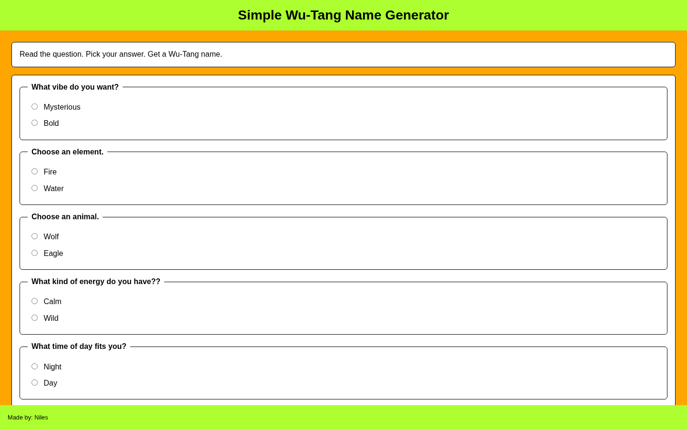

# Simple Wu-Tang Name Generator

Answer six multiple-choice questions to generate a Wu-Tang-inspired name.

## Overview

Simple Wu-Tang Name Generator asks six questions about preferences such as vibe, element, animal, energy, time of day, and style.

The browser sends the selected answers to a Node.js server. The server uses those answers to select and combine two name parts, then returns the generated name to the page.

## Features

- Six-question multiple-choice form
- Client-side answer collection and validation
- Node.js HTTP server
- API endpoint for generating the result
- Two eight-name lists used to create the final name
- Up to 64 possible name combinations
- Result displayed directly in the browser

## Technologies

<p>
  <a href="https://developer.mozilla.org/en-US/docs/Web/HTML" title="HTML">
    
  </a>
  &nbsp;
  <a href="https://developer.mozilla.org/en-US/docs/Web/CSS" title="CSS">
    
  </a>
  &nbsp;
  <a href="https://developer.mozilla.org/en-US/docs/Web/JavaScript" title="JavaScript">
    
  </a>
  &nbsp;
  <a href="https://nodejs.org/" title="Node.js">
    
  </a>
</p>

## How to Run

1. Clone the repository:

```bash
git clone https://github.com/nilesleesmith/simple-wu-tang-name-generator.git
```

2. Open the project folder:

```bash
cd simple-wu-tang-name-generator
```

3. Start the Node.js server:

```bash
node server.js
```

4. Open the application in a browser:

```text
http://localhost:8000
```

No additional packages or installation steps are required.

## Live Site

https://simple-wu-tang-name-generator.onrender.com

## Screenshots


